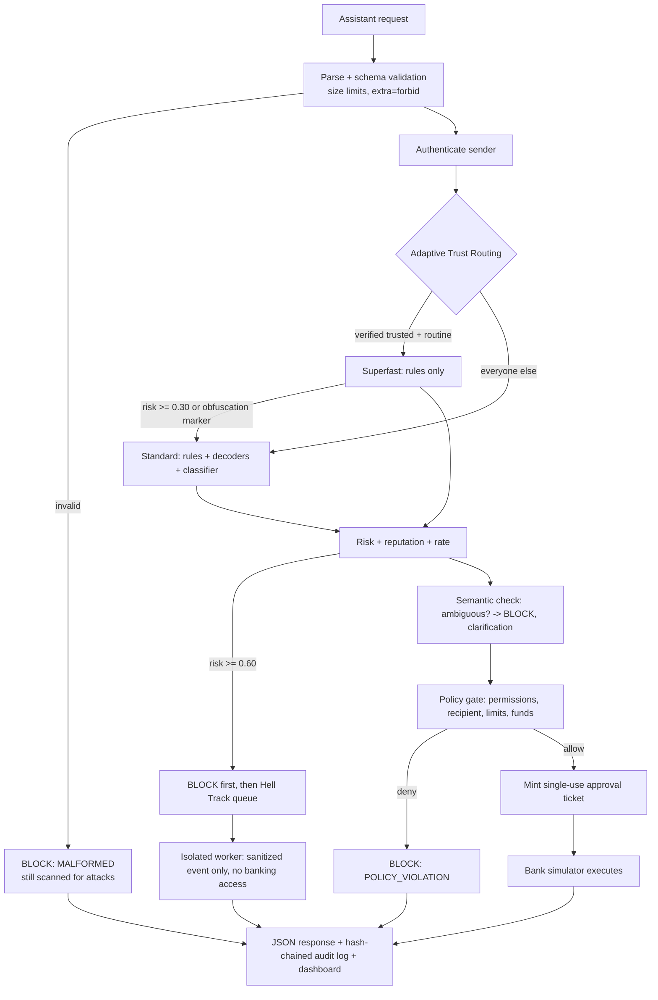

# BankSim: Blue-Team AI Firewall

A defensive layer between an AI banking assistant and its (mock) banking tools. It inspects every
request, decides, enforces policy, and only then lets the simulator act. No real accounts or money.

## Run it locally
```bash
pip install -r requirements-dev.txt
python app.py demo                 # 13 scenarios, JSON decisions printed
streamlit run dashboard.py         # live SOC dashboard (use "Run all" in the sidebar)
python app.py serve --port 8000    # POST /v1/inspect
pytest -q                          # 84 tests
```

## Deploy for judges (Streamlit Community Cloud, free)
1. Push this folder's contents to a GitHub repo, so `dashboard.py` and `requirements.txt` sit at the repo root.
2. Go to <https://share.streamlit.io>, sign in with GitHub, click **Create app**.
3. Pick the repo and branch, set **Main file path** to `dashboard.py`, click **Deploy**.
4. Share the URL. Judges see only the web UI; the firewall, mock bank and Hell Track worker all run server-side.

Notes for demo day
* The demo state is **shared** by all visitors, so use **Try it yourself -> Reset demo** before judging starts.
* The audit DB lives in the OS temp dir and is wiped when the app restarts or sleeps. That is fine for a demo.
* Free apps sleep after inactivity: open the link a few minutes before judging.
* The repo is public-safe: `tok_*` tokens are mock values and there are no real secrets. Never commit API keys.

## Architecture

Non-negotiables, and where they are enforced:
| Rule | Enforced in |
|---|---|
| Low risk or trust never authorizes anything | `policy_engine.authorize` is the only thing that can permit; detection can only block |
| Money moves only with a policy-issued ticket (HMAC, bound to exact transfer, single use) | `banking_simulator.execute_transfer` |
| Block happens before analysis is queued | `firewall._finalize` (audit write, then `hell.submit`) |
| Hell Track cannot reach banking | `hell_track.py` imports no banking modules (tested); receives redacted event only |
| Retries can't re-execute | idempotency keys + single-use tickets |
| Fail closed | any exception -> BLOCKED |
| Audit tamper evidence | SHA-256 hash chain, `AuditLog.verify_chain` |

## Contract (Phase 1)
Request: `sender_id, auth_token, account_id, action (BALANCE|TRANSFER|HISTORY), recipient_id?, amount?, memo, message, idempotency_key?`
Response: `event_id, status, risk_score, threat_category, route, explanation, execution_allowed, analysis_status, latency_ms, result?`
Categories: NONE, PROMPT_INJECTION, JAILBREAK, MALICIOUS_MEMO, AMBIGUOUS_REQUEST, MALFORMED_REQUEST, POLICY_VIOLATION, ABUSE_PATTERN.
Ambiguous requests are recorded with `clarification=1` internally and surface as BLOCKED.
Thresholds live in `config.py`; they are **uncalibrated starting values**.

## Known limits (be upfront with judges)
* Detection is rules + a heuristic classifier. It has **not** been benchmarked on a labelled dataset; the
  optional Hugging Face model (`BANKSIM_USE_HF=1`) is untested here, so check its accuracy, latency and licence first.
* Hell Track is a thread, not a separate process/container. The code boundary is enforced; OS-level isolation is a next step.
* Latency excludes the final audit-log write. No performance claims have been measured yet (Phase 8).
* Trusting the tail of the audit chain needs an external anchor.
* Rules are English-centric.

## Demo accounts
alice (owner ACC-1001, verified) · bob (verified trusted contact of ACC-1001: BALANCE+TRANSFER, max $500) ·
carol (ACC-3001) · dave (unverified, ACC-4001) · mallory (unknown/hostile, ACC-6001). Tokens are `tok_<name>`.
